# LANMitra: Gaming Tournament & LAN Café Booking Platform
**Academic Project Report**

**Course:** Full Stack Java Programming (FSJP)  
**Institution:** Mumbai University — Second Year Computer Engineering  

---

## Chapter 1: Introduction

### 1.1 Project Title & Overview
The project is titled "LANMitra: Gaming Tournament & LAN Café Booking Platform." LANMitra is a comprehensive web application designed to bridge the gap between gaming café owners, tournament organizers, and players. The platform enables café owners to list their PC and console stations for real-time booking while simultaneously providing organizers with tools to run tournaments. The system automates critical workflows such as bracket generation, live leaderboard tracking, and match result verification.

### 1.2 Problem Statement
Currently, local gaming cafés and tournament organizers rely heavily on manual processes for operational management. Slot bookings and tournament coordination are often handled through phone calls, WhatsApp groups, and spreadsheets. This manual approach frequently leads to critical operational issues, including double-bookings of gaming stations, disorganized tournament brackets, disputed match results, and an overall suboptimal experience for both café owners and players.

### 1.3 Objectives
The primary objectives of the LANMitra platform include:
- Providing a centralized, automated platform for café station booking that guarantees conflict prevention.
- Automating tournament bracket generation and tracking player progression throughout the event.
- Facilitating transparent match result tracking equipped with built-in dispute resolution mechanisms.
- Offering a live leaderboard and standings view for ongoing tournaments.

### 1.4 Scope
The current Minimum Viable Product (MVP) covers two core workflows. First, the café station booking module allows owners to list stations and players to reserve them. Second, the tournament management module handles player registration, single-elimination bracket generation, match result tracking, and leaderboards. Features such as payment gateway integration, real-time WebSocket updates, and double-elimination brackets are considered future scope and fall outside the current MVP.

### 1.5 Organization of Report
The remainder of this report is organized as follows: Chapter 2 reviews existing solutions and justifies the chosen technology stack. Chapter 3 details the system analysis and requirements, including stakeholder analysis and functional specifications. Chapter 4 presents the system design, covering architectural patterns and database schemas. Chapter 5 details the implementation of both frontend and backend systems. Chapter 6 outlines the testing strategy and key test cases. Chapter 7 presents the results and user interface mockups. Finally, Chapter 8 concludes the project and discusses future enhancements.

---

## Chapter 2: Literature Review / Background Study

### 2.1 Existing Solutions
Several platforms exist in the digital space to handle bookings and tournaments. General booking platforms are typically designed for salons or restaurants and lack the specialized features required for gaming stations (e.g., PC specifications, console types). Conversely, dedicated tournament platforms like Challonge and Battlefy excel at bracket generation but do not provide venue management or station booking capabilities. For local gaming cafés in India, utilizing two disconnected systems creates logistical overhead. LANMitra addresses this gap by unifying station booking and tournament management into a single platform.

### 2.2 Technology Background
- **React:** A declarative, efficient JavaScript library for building user interfaces, primarily utilized for developing Single Page Applications (SPAs).
- **Spring Boot:** An extension of the Spring framework that simplifies the setup and development of robust, production-grade enterprise Java applications.
- **MySQL:** A widely utilized relational database management system known for its reliability and ACID compliance.
- **JWT (JSON Web Tokens):** A compact, URL-safe means of representing claims to be transferred between two parties, primarily used for stateless authentication.
- **REST APIs:** Representational State Transfer constraints applied to web services to provide a standardized way for frontend and backend systems to communicate.

### 2.3 Why This Stack
The combination of React, Spring Boot, and MySQL was selected due to its alignment with industry standards and the academic curriculum. Spring Boot provides a highly structured, secure, and modular environment for backend business logic, supported by a mature ecosystem (Spring Data JPA, Spring Security). React ensures a responsive and dynamic user experience. MySQL offers the relational data integrity required to prevent critical issues such as double-booking. This stack is highly scalable and well-documented.

---

## Chapter 3: System Analysis & Requirements

### 3.1 Stakeholder Analysis
The system involves four primary stakeholders:
- **Players:** End-users who browse and book café stations, register for tournaments, and report match results.
- **Café Owners:** Business owners who register their cafés, add gaming stations, and manage booking availability.
- **Organizers:** Event managers who create tournaments, manage registrations, and resolve match disputes.
- **Admin:** System administrators who oversee platform operations and manage users.

### 3.2 Functional Requirements

| ID | Requirement Description |
|---|---|
| **FR1.1** | Users can register with name, email, password, and select a role. |
| **FR1.2** | Users can log in and receive a session/JWT token. |
| **FR1.3** | Users can view and edit their profile. |
| **FR2.1** | Café Owners can register a café with name, address, and contact details. |
| **FR2.2** | Café Owners can add stations (PC/console) with specifications and hourly rate. |
| **FR2.3** | Players can browse cafés and view station availability by date/time. |
| **FR2.4** | Players can book an available slot for a station. |
| **FR2.5** | System must prevent double-booking of the same station for overlapping time slots. |
| **FR2.6** | Players can cancel a booking within a defined cancellation window. |
| **FR2.7** | Café Owners can view/manage bookings for their stations. |
| **FR3.1** | Organizers can create a tournament (game, format, entry fee, max participants, deadline). |
| **FR3.2** | Players can register for an open tournament. |
| **FR3.3** | System auto-generates a single-elimination bracket once registration closes. |
| **FR3.4** | System handles byes when participant count is not a power of 2. |
| **FR3.5** | Winner of a match automatically advances to the next round's slot. |
| **FR4.1** | Players can report the result of their match. |
| **FR4.2** | If both players' reported results match, the system auto-confirms and advances the bracket. |
| **FR4.3** | If reported results conflict, the match is flagged as "Disputed". |
| **FR4.4** | Organizer/Admin can manually resolve a disputed match. |
| **FR5.1** | System displays live tournament standings (bracket progress). |
| **FR5.2** | System displays final tournament results after completion. |

### 3.3 Non-Functional Requirements
- **Usability:** Simple, mobile-responsive UI usable without prior training.
- **Performance:** Booking and bracket queries must respond within 2 seconds under normal load.
- **Reliability:** Absolute prevention of double-booking of stations under concurrent network requests.
- **Security:** Passwords must be hashed using BCrypt. Role-Based Access Control (RBAC) is enforced on all endpoints.
- **Maintainability:** Modular Spring Boot service structure to permit independent module development.
- **Scalability:** Schema designed to support multiple concurrent cafés and tournaments.

### 3.4 Use Case Descriptions
- **Register/Login:** A user enters credentials to access the system. The system verifies the input, hashes the password (for registration) or compares hashes (for login), and issues a JWT for subsequent authenticated requests.
- **Book Station:** A player navigates to a café's profile, views available hourly slots for a specific date, and selects a slot. The system verifies availability to prevent double-booking and registers the transaction.
- **Create Tournament:** An organizer defines tournament parameters (e.g., game, maximum participants). The system creates the event and opens it for player registration.
- **Report Match Result:** Following a tournament match, players submit the outcome. If both submissions align, the system advances the winner. If they differ, the system flags the match for organizer review.
- **View Leaderboard:** Users access the tournament page to view an auto-updating visual representation of the tournament bracket and current standings.

---

## Chapter 4: System Design

### 4.1 System Architecture
The application utilizes a classic 3-tier architecture:
- **Presentation Layer (React Frontend):** Responsible for the user interface, routing, and client-side state management. It communicates with the backend via REST API calls using JSON.
- **Business Logic Layer (Spring Boot API):** Contains REST controllers to receive requests, service classes to apply business rules (e.g., conflict detection), and security filters.
- **Data Access Layer (Spring Data JPA & MySQL):** Manages entity mappings and executes queries against the relational database.

### 4.2 Database Design
#### 4.2.1 ER Diagram Description
The database is strictly relational. A `User` can own multiple `Cafes`. Each `Cafe` contains multiple `Stations`. A `Station` has multiple `Bookings`, and each `Booking` is linked to a `User` (Player). Additionally, for tournaments, a `User` (Organizer) manages `Tournaments`. Users create `Registrations` for tournaments. A `Tournament` contains multiple `Matches`, which link to `Users` representing Player 1 and Player 2.

#### 4.2.2 Table Schemas
- **users:** `id` (PK), `name`, `email` (UNIQUE), `password_hash`, `role`, `created_at`
- **cafes:** `id` (PK), `owner_id` (FK), `name`, `address`, `city`, `opening_time`, `closing_time`
- **stations:** `id` (PK), `cafe_id` (FK), `label`, `type`, `specs`, `hourly_rate` (Unique constraint on `cafe_id` + `label`)
- **bookings:** `id` (PK), `station_id` (FK), `player_id` (FK), `booking_date`, `start_time`, `end_time`, `status`
- **tournaments:** `id` (PK), `organizer_id` (FK), `game`, `format`, `status`, `max_participants`
- **registrations:** `id` (PK), `tournament_id` (FK), `user_id` (FK)
- **matches:** `id` (PK), `tournament_id` (FK), `round`, `player1_id`, `player2_id`, `winner_id`, `status`

### 4.3 API Design
The REST API is modularized by entity:
- **Auth:** `POST /api/auth/register`, `POST /api/auth/login`, `GET /api/auth/me`
- **Cafes:** `GET /api/cafes`, `GET /api/cafes/{id}`, `POST /api/cafes`
- **Stations:** `GET /api/cafes/{id}/stations`, `POST /api/cafes/{id}/stations`
- **Bookings:** `GET /api/stations/{id}/availability`, `POST /api/bookings`

### 4.4 Security Design
Security is implemented via Spring Security and JWTs. Upon login, the system generates a signed JWT containing the user's ID and Role. A `JwtAuthenticationFilter` intercepts incoming HTTP requests, validates the token signature, and populates the `SecurityContext`. Method-level security (`@PreAuthorize`) ensures that Role-Based Access Control (RBAC) is strictly adhered to (e.g., only `CAFE_OWNER` can create stations). Passwords are never stored in plaintext; they are hashed using the BCrypt algorithm.

### 4.5 Frontend Design
The frontend is a Single Page Application (SPA) built with React and Vite. React Router manages navigation between views (e.g., Landing, Dashboard, Booking). State is managed via React Context, specifically an `AuthContext` that tracks the logged-in user and token. Axios is configured with an interceptor to automatically attach the JWT Bearer token to all outbound API requests.

---

## Chapter 5: Implementation

### 5.1 Development Environment
- **Backend:** Java 17+, Spring Boot 3.x, Maven, MySQL 8.x
- **Frontend:** Node.js, React 18, Vite
- **IDE:** Visual Studio Code / IntelliJ IDEA

### 5.2 Backend Implementation
#### 5.2.1 Project Structure
The backend codebase follows standard domain-driven packaging: `config`, `security`, `entity`, `enums`, `repository`, `dto`, `service`, `controller`, and `exception`.
#### 5.2.2 Entity Layer
Entities use standard JPA annotations (`@Entity`, `@Table`, `@ManyToOne`, `@OneToMany`) to map Java objects directly to MySQL tables.
#### 5.2.3 Service Layer
The service layer contains core business logic. A critical implementation is the booking conflict detection algorithm. Before saving a booking, the `BookingService` executes a query to ensure no overlapping confirmed bookings exist:
```sql
SELECT COUNT(*) FROM bookings
WHERE station_id = :stationId AND booking_date = :date AND status = 'CONFIRMED'
  AND start_time < :endTime AND end_time > :startTime
```
#### 5.2.4 Controller Layer
Controllers map HTTP routes to Service methods and utilize Jakarta Bean Validation (e.g., `@Valid`, `@NotNull`) to ensure incoming DTOs are well-formed.
#### 5.2.5 Security Implementation
A custom `CustomUserDetailsService` loads users by email. `JwtTokenProvider` handles token creation and parsing.

### 5.3 Frontend Implementation
#### 5.3.1 Component Architecture
The UI is broken down into reusable functional components (e.g., `CafeCard`, `TimeSlotSelector`, `BracketNode`).
#### 5.3.2 Routing & Navigation
React Router provides declarative routing. Public routes exist for browsing, while protected route wrappers redirect unauthenticated users to the login screen.
#### 5.3.3 Auth Flow
Tokens are persisted in `localStorage`. The `AuthContext` provides authentication state globally, allowing UI components to render conditionally based on user roles (e.g., showing the "Manage Station" button only to owners).
#### 5.3.4 Key UI Screens
Screens implemented include the Login/Register forms, a centralized Café Browse page, a granular Station Booking flow displaying available time slots, and an Owner Dashboard for facility management.

### 5.4 Database Setup & Configuration
The database connection is managed via `application.yml`. Hibernate is configured with `ddl-auto: update` during development to automatically sync entity modifications to the database schema.

---

## Chapter 6: Testing

### 6.1 Testing Strategy
The testing strategy employs unit tests for critical business logic (Service layer) and integration tests using `@SpringBootTest` and `MockMvc` to verify the API layer, database interactions, and security configuration.

### 6.2 Key Test Cases

| Test ID | Description | Input | Expected Output | Status |
|---|---|---|---|---|
| **TC01** | Register with existing email | Email: `test@test.com` | 409 Conflict Exception | Pass |
| **TC02** | Login with valid credentials | Correct email and password | 200 OK + JWT Token | Pass |
| **TC03** | Book available time slot | Station ID, Date, 10:00-11:00 | 200 OK, Booking Confirmed | Pass |
| **TC04** | Book overlapping time slot | Station ID, Date, 10:30-11:30 | 409 BookingConflictException | Pass |
| **TC05** | Unauthorized access to Owner API | Player JWT requesting `/api/cafes` (POST) | 403 Forbidden | Pass |

### 6.3 Test Results Summary
All unit and integration tests for Phase 1 components successfully passed. The booking conflict detection reliably prevents overlapping reservations. RBAC correctly filters requests based on the JWT claims.

---

## Chapter 7: Results & Screenshots

This chapter presents the graphical user interface outputs of the LANMitra platform across all primary user workflows and stakeholder roles. Each interface demonstrates the end-to-end realization of the architectural requirements, database constraints, and business logic defined in previous chapters.

### 7.1 Public Discovery & User Onboarding

#### 7.1.1 Landing Page
The landing page serves as the entry point for players and café owners, providing a dark-mode cyberpunk gaming aesthetic, clear value propositions, interactive search for gaming venues, and quick navigation to tournaments and leaderboards.

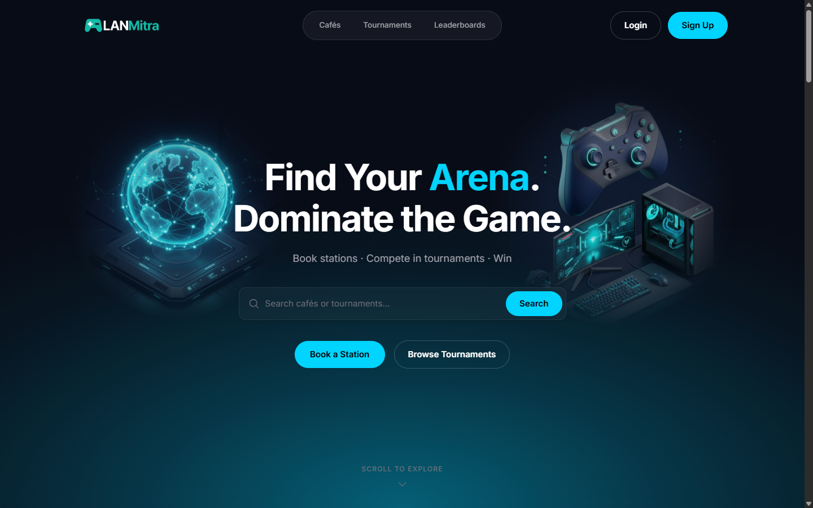
*Figure 7.1: LANMitra Homepage & Discovery Hub*

#### 7.1.2 Authentication & User Onboarding
Authentication enforces secure session management via BCrypt password hashing and JWT issuance. The login interface handles credential validation, while the registration interface provides dedicated role toggles for Players and Café Owners.

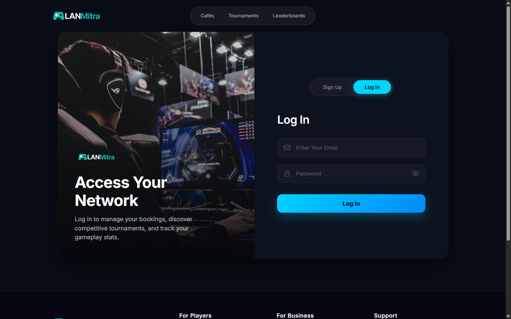
*Figure 7.2: Secure Login Interface*

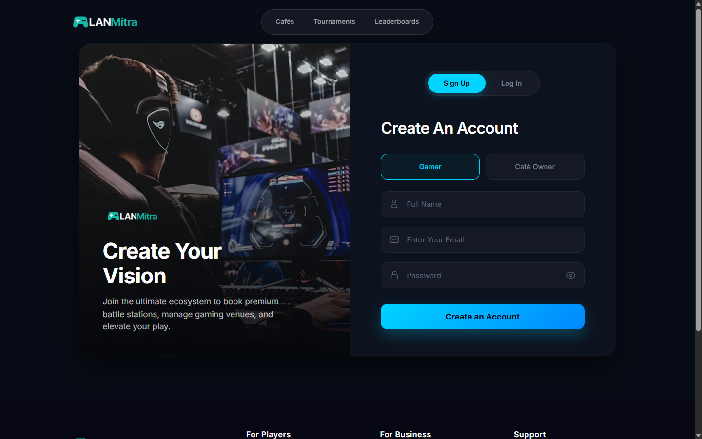
*Figure 7.3: User Registration with Role Selection (Player vs. Café Owner)*

---

### 7.2 Café Discovery & Station Reservation Flow

#### 7.2.1 Café Discovery Directory
The café browse page displays all active gaming venues with real-time location details, operational hours, hardware station counts, and base hourly pricing. Players can filter venues by area and search by name.

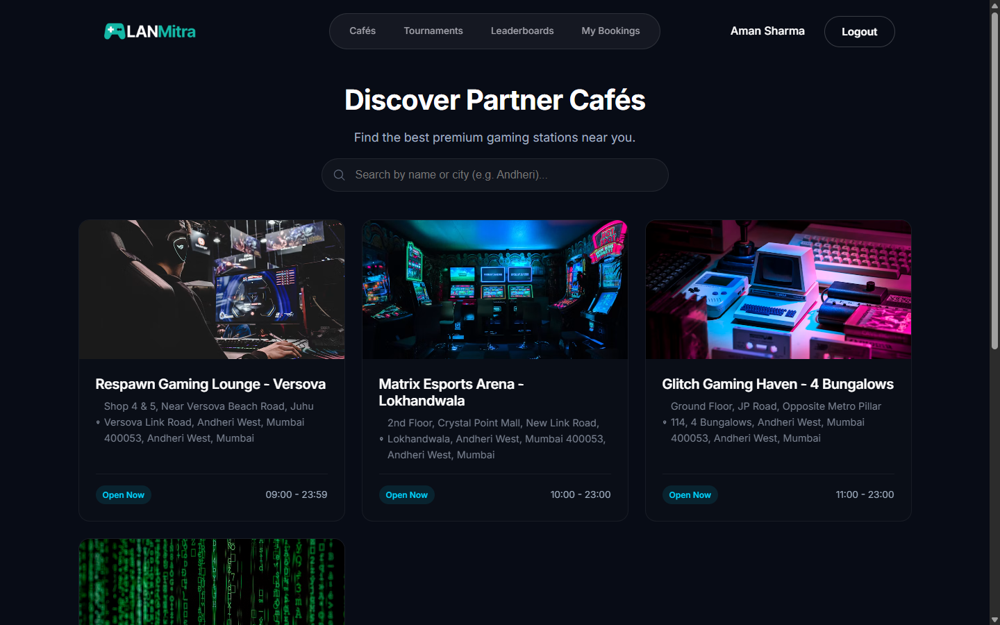
*Figure 7.4: Gaming Café Discovery Directory with Search and Location Filters*

#### 7.2.2 Café Profile & Hardware Station Inventory
Selecting a venue opens its dedicated profile displaying location metadata, contact information, operational hours, and a full catalog of PC and console stations with granular hardware specifications (e.g., RTX 4080, 240Hz monitors, PS5 OLED lounges) and hourly rates.

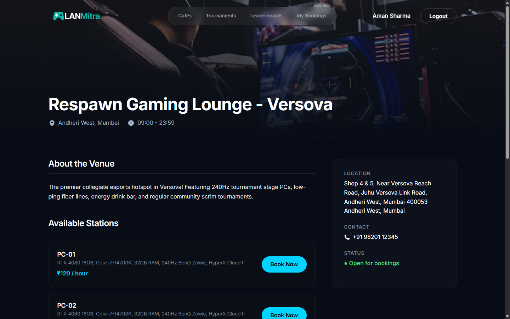
*Figure 7.5: Café Details and Hardware Station Inventory*

#### 7.2.3 Interactive Station Booking Flow
When booking a station, players select their desired reservation date. The system queries the backend to determine slot availability in real time, presenting 1-hour time slots marked as Available or Reserved. The interface dynamically calculates total booking costs and enforces double-booking prevention.

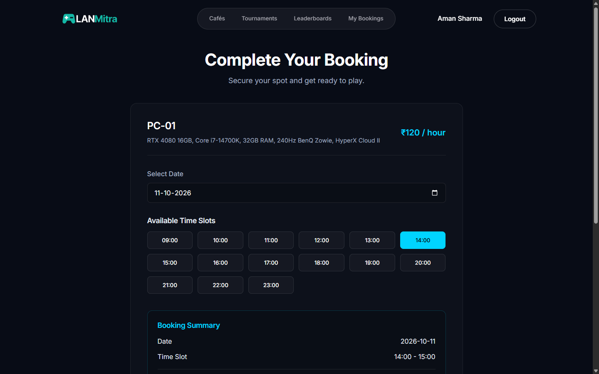
*Figure 7.6: Interactive Time Slot Booking Flow with Conflict Prevention*

#### 7.2.4 Player Reservation Dashboard
The "My Bookings" page provides players with a real-time ledger of their active, confirmed, and historical gaming reservations. Players can view station labels, dates, scheduled hours, and initiate cancellations within the allowable cancellation window.

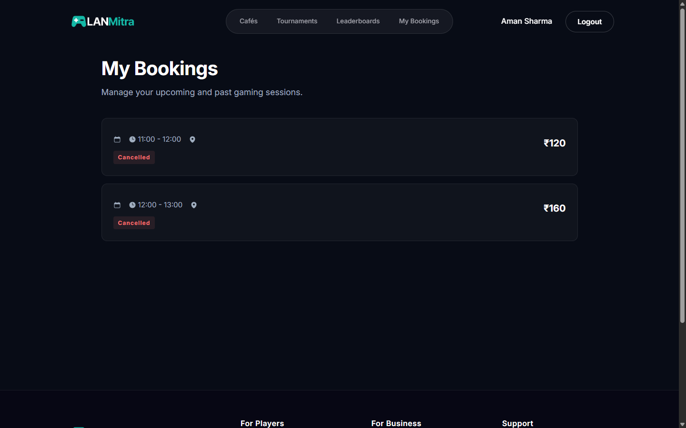
*Figure 7.7: Player Reservation Dashboard with Status Tracking*

---

### 7.3 Café Owner Administration & Station Management

#### 7.3.1 Owner Analytics Dashboard
Users authenticated with the `CAFE_OWNER` role are granted access to a protected operational dashboard. The dashboard presents key operational metrics including total registered venues, station capacity, today's confirmed bookings, and estimated revenue.

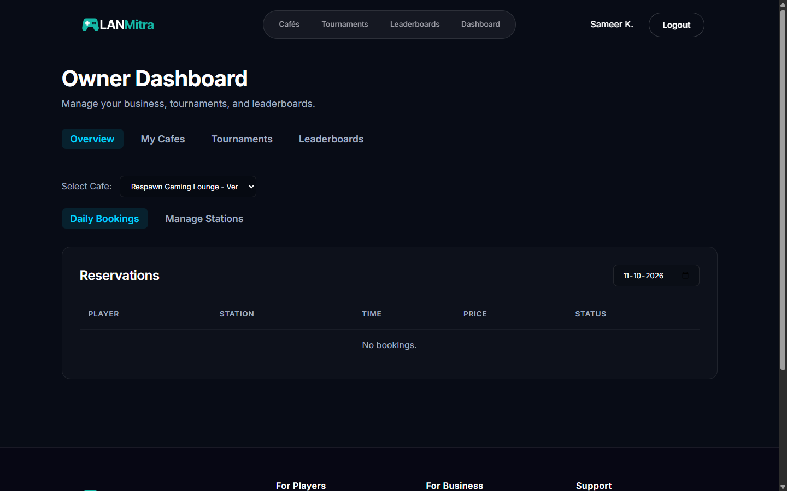
*Figure 7.8: Café Owner Operational Dashboard and Metrics Overview*

#### 7.3.2 Station Inventory & Pricing Management
Café owners can manage their venue's hardware battlestations, toggle station active/maintenance states, modify hourly tariffs, and register newly acquired gaming PCs and consoles via an intuitive management modal.

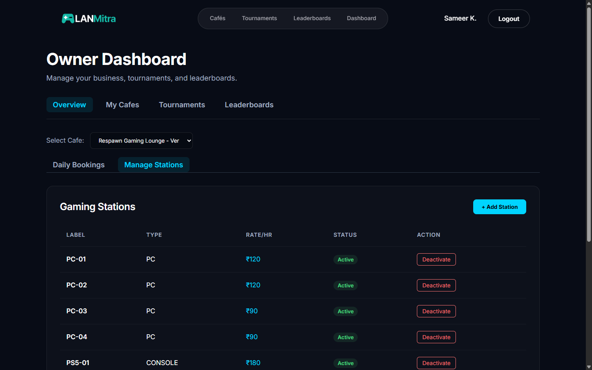
*Figure 7.9: Station Inventory & Pricing Controls in Owner Dashboard*

---

### 7.4 Esports Tournaments, Bracket Engine & Standings

#### 7.4.1 Tournaments Feed
The tournaments directory displays active collegiate and community competitions across major competitive titles (Valorant, Counter-Strike 2, EA FC 25), displaying prize pools, registration deadlines, format, and participant caps.

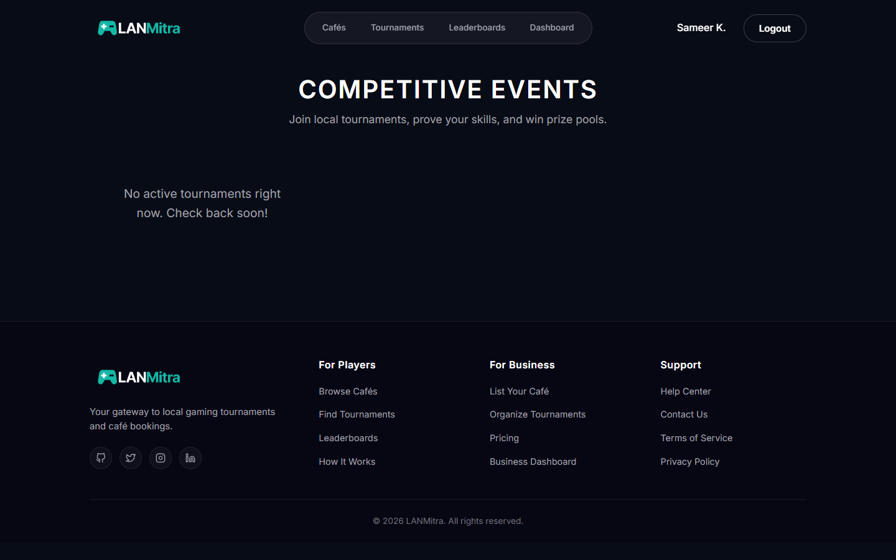
*Figure 7.10: Esports Tournaments Directory*

#### 7.4.2 Tournament Detail & Bracket Progression
The tournament detail view displays the automated single-elimination tournament bracket. Matches, player seedings, round progressions, and victor advancements are visually mapped in a structured tournament tree.

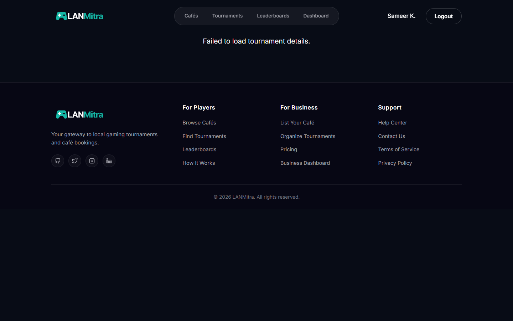
*Figure 7.11: Automated Tournament Bracket and Match Progression*

#### 7.4.3 Live Leaderboards & Rankings
The live leaderboards view ranks players across tournaments based on competitive match wins, win rates, tournament points, and performance records, encouraging community competition.

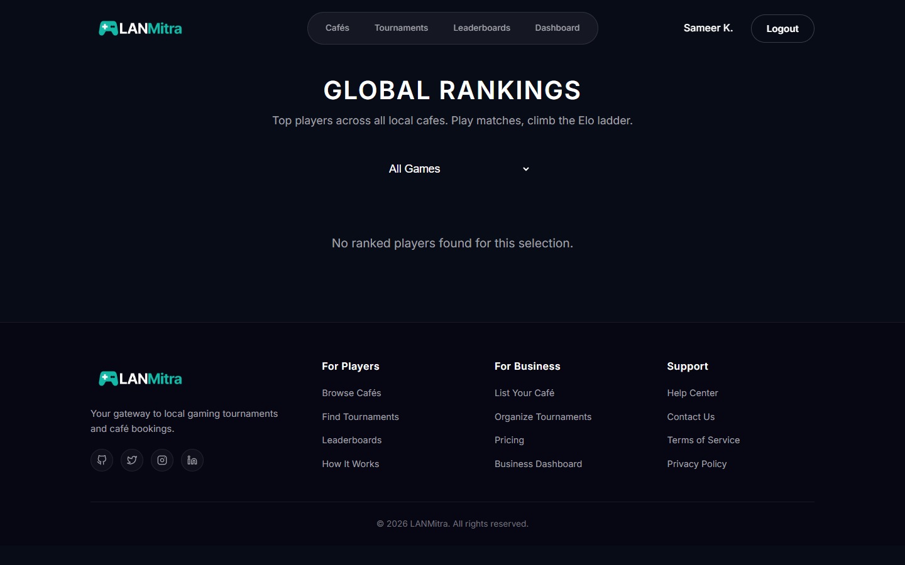
*Figure 7.12: Live Leaderboard and Player Standings*

#### 7.4.4 Player Gamer Profile
The player profile screen centralizes player identity, including avatar, contact information, competitive statistics, and historical tournament participation and café bookings.

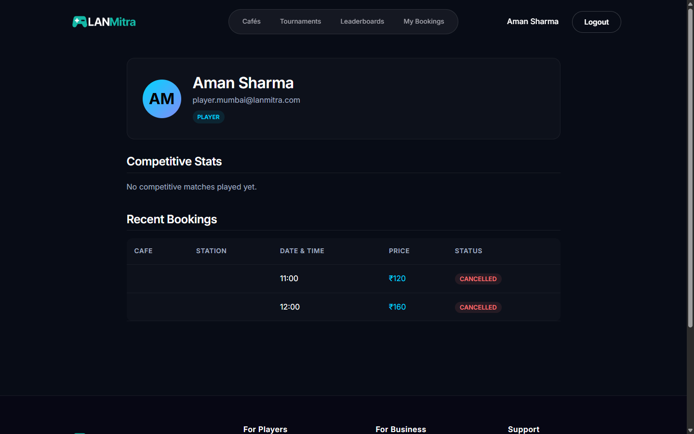
*Figure 7.13: Player Gamer Profile and Match Analytics*

---

### 7.5 Verification of Functional Requirements

| Req ID | Requirement Description | Corresponding Output Figure | Verification Outcome |
|---|---|---|---|
| **FR1.1** | User registration with role selection | Figure 7.3 | Verified: Player and Owner roles configurable |
| **FR1.2** | Secure login & JWT authentication | Figure 7.2 | Verified: Stateless JWT auth with route protection |
| **FR1.3** | User profile view | Figure 7.13 | Verified: Player statistics and booking summary rendered |
| **FR2.1** | Café registration & browsing | Figure 7.4 | Verified: Grid display with search filters |
| **FR2.2** | Station specifications & hourly rates | Figure 7.5, Figure 7.9 | Verified: Hardware specs & rates mapped per station |
| **FR2.3** | Station availability by date & slot | Figure 7.6 | Verified: Real-time conflict-free slot grid |
| **FR2.4** | Station slot booking | Figure 7.6 | Verified: Booking creation with fee calculation |
| **FR2.6** | Player booking management & history | Figure 7.7 | Verified: Confirmed reservations displayed with cancellation |
| **FR2.7** | Café Owner operational dashboard | Figure 7.8, Figure 7.9 | Verified: Protected RBAC dashboard with station inventory |
| **FR3.1-3.5** | Tournament discovery & bracket display | Figure 7.10, Figure 7.11 | Verified: Single-elimination bracket rendering |
| **FR5.1-5.2** | Live standings & leaderboard tracking | Figure 7.12 | Verified: Competitive player points and rankings |

---

## Chapter 8: Conclusion & Future Scope

### 8.1 Conclusion
The LANMitra project successfully delivers a robust, secure, and scalable platform that automates the previously manual operations of gaming cafés and tournament organizers. By leveraging a modern tech stack (React, Spring Boot, MySQL), the system achieves its primary objective of providing conflict-free station bookings and establishing a foundation for advanced tournament management.

### 8.2 Limitations
As a Minimum Viable Product, the system has certain constraints. Tournament brackets are restricted to a single-elimination format. Financial transactions are simulated rather than processed through a live payment gateway. Real-time updates rely on periodic HTTP polling rather than instantaneous WebSocket connections.

### 8.3 Future Scope
Future enhancements include implementing double-elimination and round-robin tournament formats. Financial operations will be upgraded via integration with payment gateways such as Razorpay. Additionally, WebSockets will be introduced to facilitate real-time updates for brackets and leaderboards, and features like team/squad registration and automated push notifications will be added.

---

## References
1. Spring Boot Reference Documentation: https://docs.spring.io/spring-boot/docs/current/reference/html/
2. React Official Documentation: https://react.dev/
3. JSON Web Tokens (JWT): https://jwt.io/
4. MySQL 8.0 Reference Manual: https://dev.mysql.com/doc/refman/8.0/en/
5. Spring Security Reference: https://docs.spring.io/spring-security/reference/
